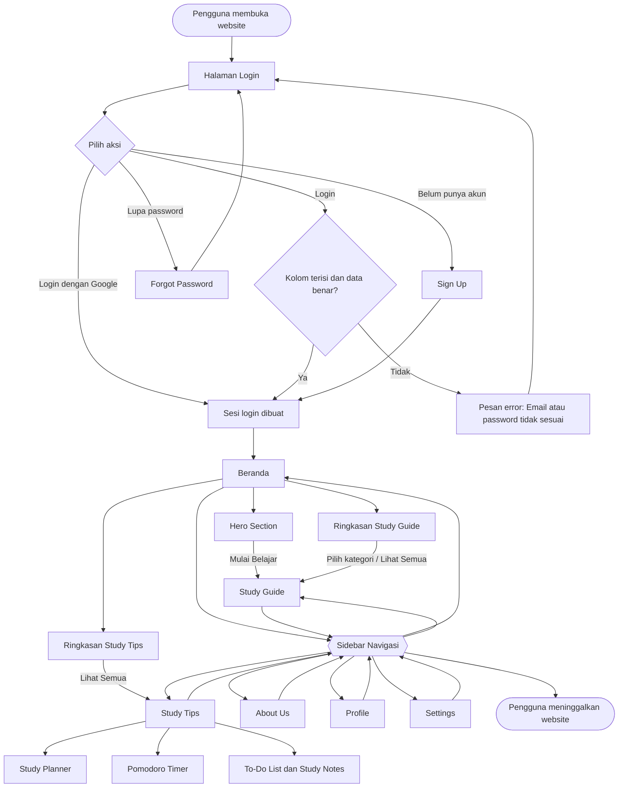

# Site Structure StudySpace

Dokumen struktur navigasi dan alur halaman website **StudySpace**. Rincian kebutuhan ada di [`requirements.md`](../requirements.md).

> **Catatan:** halaman Login, Sign Up, dan Forgot Password dimasukkan mengikuti alur sistem pada `requirements.md`. Alur Sign Up dan Forgot Password belum ditentukan tim, jadi ditandai sebagai *belum ditentukan*. Jika tim memutuskan tanpa login, bagian tersebut dapat dihapus.

---

## 1. Daftar Halaman

| No | Halaman | Akses | Isi Utama |
|---|---|---|---|
| 1 | Login | Halaman pertama | Form email dan password, login dengan Google, tautan Forgot password dan Sign up |
| 2 | Sign Up | Dari Login | *Belum ditentukan* |
| 3 | Forgot Password | Dari Login | *Belum ditentukan* |
| 4 | Beranda (Homepage) | Sidebar | Hero Section, ringkasan Study Guide, ringkasan Study Tips |
| 5 | Panduan Belajar (Study Guide) | Sidebar, tombol Mulai Belajar, Lihat Semua | 4 metode dan 4 kategori panduan |
| 6 | Tips Belajar (Study Tips) | Sidebar, Lihat Semua | Study Planner, Pomodoro Timer, To-Do List & Study Notes |
| 7 | Tentang Kami (About Us) | Sidebar | Latar belakang, tujuan, kaitan SDG 4, profil kelompok |
| 8 | Profile | Sidebar | Profil pengguna |
| 9 | Settings | Sidebar | Pengaturan |

## 2. Struktur Navigasi (Hierarki)

```
StudySpace
├── Login
│   ├── Sign Up                       (belum ditentukan)
│   └── Forgot Password               (belum ditentukan)
│
└── Halaman Utama (setelah login, dengan sidebar navigasi)
    ├── Beranda (Homepage)
    │   ├── Hero Section
    │   │   └── Tombol "Mulai Belajar" → Study Guide
    │   ├── Ringkasan Study Guide
    │   │   ├── Manajemen Waktu
    │   │   ├── Metode Belajar
    │   │   ├── Teknik Mencatat
    │   │   ├── Persiapan Ujian
    │   │   └── Lihat Semua → Study Guide
    │   └── Ringkasan Study Tips
    │       ├── Atur Jadwal Belajar
    │       ├── Gunakan Metode Pomodoro
    │       ├── Jaga Kesehatan
    │       └── Lihat Semua → Study Tips
    │
    ├── Panduan Belajar (Study Guide)
    │   ├── Metode
    │   │   ├── Pomodoro
    │   │   ├── Cornell Notes
    │   │   ├── Active Recall
    │   │   └── Spaced Repetition
    │   └── Kategori
    │       ├── Manajemen Waktu
    │       ├── Metode Belajar
    │       ├── Teknik Mencatat
    │       └── Persiapan Ujian
    │
    ├── Tips Belajar (Study Tips)
    │   ├── Study Planner
    │   ├── Pomodoro Timer
    │   └── To-Do List & Study Notes
    │
    ├── Tentang Kami (About Us)
    ├── Profile
    └── Settings
```

## 3. Flowchart Navigasi



## 4. Struktur Sidebar Navigasi

| Urutan | Menu | Tujuan |
|---|---|---|
| 1 | Homepage | Beranda |
| 2 | Study Guide | Halaman Panduan Belajar |
| 3 | Study Tips | Halaman Tips Belajar |
| 4 | About Us | Halaman Tentang Kami |
| 5 | Profile | Halaman Profile |
| 6 | Settings | Halaman Settings |

## 5. Peta Berkas

| Halaman | Berkas |
|---|---|
| Semua halaman | `index.html` (satu berkas, atau dipisah per halaman jika tim memutuskan demikian) |
| Tampilan | `css/style.css` |
| Fitur interaktif (Study Planner, Pomodoro, To-Do, Notes) | `js/script.js` |
| Gambar | `assets/images/` |
